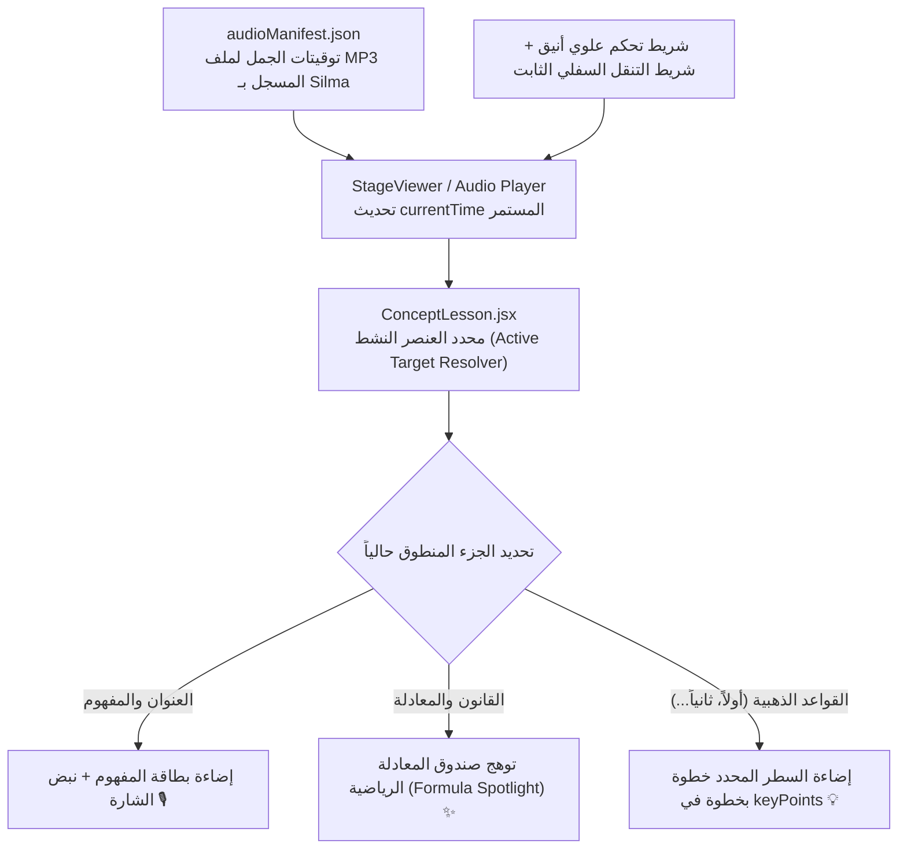

# خطة العمل: التزامن البصري التفاعلي لشرح الدروس مع صوت Silma TTS

تستهدف هذه الخطة الاستجابة لطلبكم بإلغاء/إخفاء صندوق **"الشرح الصوتي التفاعلي"** المنفصل القديم أسفل الدرس، واستبداله بنظام **تزامن بصري ذكي ومباشر (`Live Interactive Visual-Audio Sync`)**، بحيث تتفاعل بطاقات ومفاهيم وقوانين الدرس ذاتها على الشاشة لحظياً وبشكل حيوي مع صوت المعلم المسجل عبر **Silma AI**، مما يمنح الطالب تجربة متابعة بصرية وسمعية متكاملة وممتعة.

---

## 1. الخيارات وأفضل الطرق لتنفيذ المطلوب (Best Architectural Approaches)

نطرح أمامكم **3 خيارات معمارية وتصميمية** مدروسة لتفاعل المحتوى البصري مع الصوت:

---

### الخيار الأول (الموصى به بشدة ⭐): "التظليل والتأطير الإشعاعي التفاعلي للعناصر" (Granular Real-Time Spotlight)
في هذا الخيار، تظل واجهة الدرس بنسقها الجمالي الحديث، لكنها تتحول إلى **لوحة تعليمية تفاعلية حية** تتناغم مع صوت المعلم:

1. **إضاءة وتأطير البطاقة النشطة (`Active Card Halo`):**
   - عندما يبدأ المعلم بشرح مفهوم معين، تتوهج حدود البطاقة بالكامل بلون الهوية الأزرق السماوي (`#39A9D0`) مع ظل إشعاعي خفيف (`shadow-glow-primary`) ونبض هادئ (`gentle breathing pulse`).
   - تظهر شارة حية في أعلى البطاقة:  
     `🎙️ الأستاذ يشرح الآن...` مع أيقونة أمواج صوتية متحركة.
2. **تسليط الضوء على صندوق المعادلة والقانون الرياضي (`Formula Spotlight`):**
   - عندما يصل صوت المعلم إلى قراءة القانون الرياضي ("القانون والمعادلة الرياضية: ..."):
   - يتوهج صندوق المعادلة باللون الذهبي (`#E5A91B ring-2`)، وتكبر المعادلة بنسبة خفيفة (`scale-[1.02]`) لتجذب بصر الطالب فوراً إلى الرموز والأرقام أثناء سماعها.
3. **تظليل القواعد والخطوات الذهبية خطوة بخطوة (`Step-by-Step Rule Highlight`):**
   - عندما يشرح المعلم القاعدة الأولى: تضاء النقطة الأولى بخلفية زرقاء خفيفة وعلامة صح متوهجة.
   - عندما ينتقل للقاعدة الثانية: يضيء السطر الثاني بسلاسة وهكذا، ليعرف الطالب بدقة أي خطوة تتم مناقشتها الآن.
4. **التفاعل العكسي بالنقر (`Click to Listen & Seek`):**
   - يمكن للطالب النقر على أي قانون أو أي قاعدة للقفز بالصوت مباشرة إلى لحظة شرح ذلك القانون!
5. **شريط تحكم عائم مدمج وأنيق (`Floating Mini Audio Header`):**
   - بدلاً من صندوق التفريغ النصي القديم الضخم، يظهر شريط تحكم عائم فائق الأناقة أعلى الدرس يوضح:  
     `[زر التشغيل/الإيقاف] [عنوان الدرس] [شارة: صوت الأستاذ الافتراضي Silma AI 🎙️] [عداد التوقيت 01:15 / 01:40] [محدد السرعة 0.8x, 1.0x, 1.2x]`.

---

### الخيار الثاني: "نمط العرض المسرحي المتدرج" (Stage Spotlight Focus)
- يتم تخفيف عتامة (`Opacity: 40%`) البطاقات والعناصر غير المشروحة حالياً، مع التركيز بـ `Opacity: 100%` وحجم أكبر للبطاقة أو القانون الذي يشرحه المعلم الآن.
- ينتقل التركيز كمسرح تعليمي بين أجزاء الدرس.
- **ميزته:** تركيز انتباه الطالب 100% على جزء واحد فقط.
- **ملاحظة:** قد يفضل بعض الطلاب رؤية كل محتوى الصفحة بوضوح دون تغبيش الأجزاء الأخرى.

---

### الخيار الثالث: "الخط الزمني للمفاهيم" (Interactive Timeline Stepper)
- يظهر شريط تقدم علوي يعرض محطات الدرس:  
  `[1. المفهوم والقيمة المكانية] ──> [2. القانون والمعادلة] ──> [3. قواعد الحل الذهبية]`.
- تتقدم المحطة تلقائياً مع الصوت، وعند النقر على أي محطة يتم التمرير إليها وتشغيل مقطعها.

---

## 2. جدول المقارنة بين الطرق

| الميزة | الخيار 1 (التأطير الإشعاعي التفاعلي ⭐) | الخيار 2 (العرض المسرحي Focus) | الخيار 3 (الخط الزمني Stepper) |
| :--- | :---: | :---: | :---: |
| **إخفاء صندوق الشرح القديم** | ✅ نعم بالكامل | ✅ نعم بالكامل | ✅ نعم بالكامل |
| **تظليل القوانين والمعادلات** | ✅ توهج فوري لصندوق القانون | ✅ تسليط الضوء المسرحي | ❌ فقط تنقل للمحطة |
| **تتبع القواعد خطوة بخطوة** | ✅ إضاءة كل قاعدة على حدة | ⚠️ تظليل كلي للبطاقة | ❌ عام |
| **سهولة القراءة الكلية** | ⭐⭐⭐ مريح جداً للعين | ⭐⭐ يقلل عتامة باقي الدرس | ⭐⭐⭐ جيد |
| **إمكانية النقر والقفز الصوتي** | ✅ نعم على أي معادلة أو قاعدة | ✅ على البطاقة | ✅ على المحطة فقط |

---

## 3. المخطط المعماري لسير العمل المعتمد (الخيار الأول الموصى به)



---

## 4. خطة التعديلات البرمجية التفصيلية (Proposed Changes)

### [MODIFY] `src/components/stage/ConceptLesson.jsx`
1. **حذف/إخفاء صندوق `AudioNarrator` النصي القديم:**
   - إزالة استدعاء مكون `AudioNarrator` من أسفل الدرس والاكتفاء بالتحكم الصوتي المدمج.
2. **إضافة شريط تحكم عائم مدمج بأعلى منطقة الشرح (`Mini Audio Bar`):**
   - تصميم أنيق مضغوط يوضح حالة الصوت، زر التشغيل السريع، اسم الدرس، شارة Silma AI، وشريط تقدم زمني ناعم مع محدد السرعات (0.8x, 1x, 1.2x).
3. **تطبيق منطق التزامن المباشر (`Active Highlight Logic`):**
   - مقارنة الجملة الحالية `currentSentenceIdx` مع عناصر بطاقات الدرس:
     - فحص هل الجملة الحالية تتناول المفهوم أو العنوان -> تفعيل شارة `🎙️ المعلم يشرح الآن` وتوهج كادر البطاقة.
     - فحص هل الجملة تتناول "القانون" أو "المعادلة" -> إضافة كلاس توهج ذهبي لصندوق المعادلة:  
       `ring-2 ring-[#E5A91B] shadow-[0_0_25px_rgba(229,169,27,0.35)] scale-[1.01] transition-all duration-300`.
     - فحص هل الجملة تتناول إحدى القواعد (أولاً، ثانياً...) -> تظليل عنصر `keyPoint` المطابق بلون أزرق سماوي مضيء وعلامة صح متوهجة.
4. **دعم القفز الصوتي التفاعلي بالنقر (`Click to Seek`):**
   - عند نقر الطالب على صندوق المعادلة، يتم استدعاء `onStartSpeakingSentence(formulaSentenceIdx)` للقفز مباشرة إلى شرح القانون.
   - عند نقر الطالب على أي قاعدة في القائمة، يتم القفز بالصوت فوراً إلى تلك القاعدة.

### [MODIFY] `src/components/stage/StageViewer.jsx`
- التأكد من تمرير توقيتات `currentTime` و `currentSentenceIdx` بدقة عالية لمكون `ConceptLesson`.
- الحفاظ على تزامن زر التشغيل/الإيقاف بشريط التنقل السفلي الثابت مع هذا التفاعل البصري.

---

## 5. خطة الاختبار والتحقق (Verification Plan)

### التحقق البصري والوظيفي:
1. **اختبار التزامن مع صوت Silma:**
   - فتح الدرس 1-1 والضغط على زر التشغيل:
   - التأكد من إضاءة بطاقة المفهوم أولاً مع ظهور شارة `المعلم يشرح الآن 🎙️`.
   - التأكد من توهج صندوق المعادلة الرياضية فور بدء المعلم في قول: "القانون والمعادلة الرياضية: العدد أربعمائة وستة وخمسون...".
   - التأكد من إضاءة القواعد الخمس بالترتيب واحدة تلو الأخرى مع نطق المعلم (أولاً، ثانياً، ثالثاً، رابعاً، خامساً).
2. **اختبار القفز التفاعلي:**
   - النقر على صندوق المعادلة والتأكد من انتقال الصوت المعلم فوراً إلى جملة القانون.
   - النقر على القاعدة "رابعاً" والتأكد من انتقال الصوت والقراءة إليها مباشرة.
3. **اختبار النظافة البصرية:**
   - التأكد من اختفاء صندوق التفريغ النصي القديم الضخم، وأن الصفحة أصبحت نظيفة ومريحة وسهلة المتابعة.
4. **اختبار البناء النهائي:**
   ```powershell
   npm run build
   ```

---

يرجى مراجعة الخطة واختيار الطريقة التي تفضلها (نوصي بـ **الخيار الأول** لجماله وفاعليته التعليمية)، ثم الضغط على زر **Proceed** أو الرد بالموافقة لنبدأ التنفيذ فوراً!
