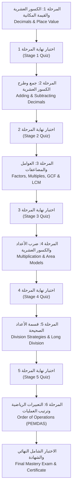

# خطة تصميم وتطوير منصة الرياضيات التفاعلية - الصف الخامس الابتدائي
## (MathVerse 5 - Interactive 5th Grade Mathematics Learning Platform)

---

## 1. وصف الهدف والمشروع (Goal Description)
بناء بيئة ويب تفاعلية تعليمية متطورة وحديثة وموجهة لطلاب الصف الخامس الابتدائي لتدريس منهج الرياضيات بشكل ممتع وتفاعلي، تحقق الشروط التالية:
1. **تقسيم المنهج إلى مراحل تعليمية تدريجية (Stages / Modules)**، تنتهي كل مرحلة باختبار تفاعلي لقياس الاستيعاب ومنح شارات الإتقان.
2. **وسائط تعليمية متعددة لكل درس ومرحلة**:
   - **شرح صوتي تفاعلي (Interactive Arabic Voice Narration)**: سرد صوتي للشرح مع إمكانية التشغيل والإيقاف والمزامنة التفاعلية.
   - **رسومات تفاعلية ونماذج بصرية ديناميكية (Visuals & Interactive Manipulatives)**: معامل رقمية مثل جدول القيمة المكانية العشري، نموذج مساحة المستطيل، شبكة الأجزاء من مائة، وخط الأعداد.
   - **شروحات فيديو احترافية (Video Lessons)**: مشغل فيديو تعليمي مدمج مع نقاط توقف تفاعلية (Interactive Checkpoints).
3. **لغة المحتوى والقواعد الحسابية (Strict Numbering & Math Rule)**:
   - لغة التوجيه والشرح والقوائم والتغذية الراجعة باللغة العربية الفصحى الواضحة والمشجعة للطفل.
   - **كافة الأرقام والمعادلات الرياضية تظهر دائماً وأبداً بالإنجليزية** (English numerals `0, 1, 2, 3...` and formulas like `2.45 + 1.3 = 3.75`, `\frac{3}{4}`, `5 \times 12 = 60`).
4. **تطبيق هوية وكالة eDesign (eDesign Agency Unified Web UI & Branding Rules)**:
   - تضمين الشعار الأبيض المعتمد كـ Data URI في الهيدر والتذييل.
   - تضمين أيقونة الـ Favicon الرسمية.
   - شريط التذييل الموحد المتوافق مع معايير الهوية باتجاه LTR وتفاصيل `v4.0.0 Enterprise`.

---

## 2. هيكل منهج الصف الخامس الابتدائي المعتمد (Curriculum Roadmap)



### تفاصيل المراحل التعليمية (Curriculum Content):
1. **المرحلة 1: القيمة المكانية والكسور العشرية (Place Value & Decimals)**
   - أجزاء العشرة وأجزاء المائة والألف (`Tenths, Hundredths, Thousandths`).
   - قراءة وكتابة الكسور العشرية بالصيغ المختلفة (القياسية، اللفظية، الممتدة).
   - مقارنة الكسور العشرية وترتيبها وتقريبها لأقرب وحدة أو جزء من عشرة أو مائة.
   - **الأداة التفاعلية**: جدول القيمة المكانية التفاعلي (Interactive Place Value Slider & Base-10 Grid).

2. **المرحلة 2: جمع وطرح الكسور العشرية (Operations on Decimals)**
   - استراتيجيات النمذجة (شبكات المائة `10x10 Grid`).
   - خوارزمية الجمع والطرح المعيارية مع محاذاة العلامة العشرية (`Decimal Alignment`).
   - حل مسائل حياتية وتطبيقات واقعية.
   - **الأداة التفاعلية**: شبكة الأجزاء من مائة الملونة تفاعلياً لتمثيل الجمع والطرح بالضغط والتلوين.

3. **المرحلة 3: العلاقات بين الأعداد - العوامل والمضاعفات (Factors & Multiples)**
   - تحليل الأعداد إلى عواملها الأولية (`Prime Factorization`).
   - العامل المشترك الأكبر (`GCF`) والمضاعف المشترك الأصغر (`LCM`).
   - مخطط فن (`Venn Diagram`) التفاعلي لاستخراج `GCF` و `LCM`.
   - **الأداة التفاعلية**: معمل شجرة العوامل ومخطط فن التفاعلي.

4. **المرحلة 4: الضرب ونموذج مساحة المستطيل (Multiplication & Area Model)**
   - ضرب الأعداد الصحيحة باستخدام نموذج المساحة (`Area Model`).
   - خاصية التوزيع وخوارزمية الضرب المعيارية.
   - ضرب الكسور العشرية وتحريك العلامة العشرية.
   - **الأداة التفاعلية**: محاكي نموذج المساحة الديناميكي لضرب عددين مع تقسيم الأبعاد وحساب المجاميع الجزئية.

5. **المرحلة 5: قسمة الأعداد الصحيحة (Division of Whole Numbers)**
   - مفهوم القسمة ونموذج مساحة المستطيل للقسمة وخوارزمية التجزئة.
   - القسمة المطولة القياسية (`Standard Long Division`) خطوة بخطوة.
   - التحقق من معقولية الناتج وباقي القسمة (`Remainder`).
   - **الأداة التفاعلية**: مساعد القسمة المطولة خطوة بخطوة مع إدخال تفاعلي.

6. **المرحلة 6: التعبيرات العددية وترتيب العمليات (Order of Operations)**
   - الأقواس، الضرب والقسمة، الجمع والطرح (`PEMDAS / BODMAS`).
   - حل المعادلات وإيجاد قيمة المجهول.
   - **الأداة التفاعلية**: آلة تفكيك التعبيرات الرياضية خطوة بخطوة مع توهج العملية النشطة.

---

## 3. الخصائص التفاعلية والتقنية للمنصة (Interactive Features)

### أ. الشرح الصوتي التفاعلي (Interactive Voice Narration):
- محرك نطق ذكي باللغة العربية الفصحى المبسطة مدعوم بـ Web Speech Synthesis ومؤثرات صوتية محفزة (Sound FX للتشجيع، الإجابات الصحيحة، والتنقل).
- إمكانية قراءة شرح كل فقرة بمجرد الضغط على زر الاستماع، مع تظليل النص المقروء في الوقت الفعلي (`Read-along Karaoke Highlighting`).
- إمكانية التحكم في سرعة القراءة (`1x`, `0.8x`, `1.2x`) لتناسب جميع مستويات استيعاب الطلاب.

### ب. شروحات الفيديو التفاعلية (Video & Animated Canvas):
- مشغل فيديو مدمج لكل مرحلة يحتوي على مقاطع توضيحية فيديو مع شريط تقدم تفاعلي.
- "محطات التحقق الذكية" (`Interactive Video Checkpoints`): يتوقف الفيديو تلقائياً عند الدقيقة المحددة ليطرح سؤالاً سريعاً على الطالب؛ وعند الإجابة الصحيحة يستأنف الشرح.

### ج. الأدوات الرياضية المعملية (Interactive Math Manipulatives):
- بناء أدوات حية تفاعلية تعتمد على HTML5 Canvas / SVG و React تفاعلية:
  1. **لوحة القيمة المكانية الرقمية**: يحرك الطالب الأشرطة ويرى التمثيل الممتد والمعياري فوراً.
  2. **مستطيل المساحة للضرب**: يدخل الطالب الأرقام (مثل $24 \times 15$) فيتولد المستطيل مقسماً إلى 4 مناطق تفاعلية تحسب نواتج الضرب الجزئية فوراً.
  3. **شبكة الأجزاء العشرية (Grid 10x10)**: شبكة 100 مربع ملونة لتوضيح جمع $0.35 + 0.42 = 0.77$.
  4. **شجرة العوامل الأولية**: يضغط الطالب على العدد فيتفرع إلى عوامله مع تمييز الأعداد الأولية.

### د. نظام الاختبارات الذكي في نهاية كل مرحلة (End-of-Stage Assessment Engine):
- بنك أسئلة لكل مرحلة يشمل أنماط متنوعة:
  - اختيار من متعدد مع تمثيل بصري.
  - إدخال مباشر للأرقام والكسور.
  - سحب وإفلات وإكمال التعبيرات.
- تقييم فوري مع تغذية راجعة وشرح خطوة بخطوة بالحل النموذجي.
- تأثيرات احتفالية (Confetti) عند اجتياز الاختبار بنجاح (80% فما فوق).
- بطاقة أداء وإنجاز تصدر للطالب (مع إمكانية الطباعة أو التحميل كشهادة تقدير رسمية باسمه).

### هـ. التطبيق الصارم للأرقام بالإنجليزية والمعادلات (English Math Standard):
- استخدام خطوط متناسقة تضمن كتابة الأرقام بالإنجليزية (`font-feature-settings: "tnum" 1, "cv01" 1` أو خطوط مخصصة مثل `Inter` و `Fira Code` للأرقام)، مع استخدام KaTeX لعرض الصيغ الرياضية بجمالية متناهية.
- نصوص اللغة العربية مكتوبة بخط عربي حديث وواضح (`Cairo` أو `Tajawal` أو `IBM Plex Sans Arabic`).

---

## 4. الهيكل التقني للمشروع وملفات البناء (Architecture & File Structure)

سيتم بناء التطبيق كتطبيق ويب حديث متكامل يعتمد على Vite + React + Tailwind CSS لسرعة الاستجابة وأعلى مستويات التفاعل والجمال البصري:

```
c:\Users\Ezz\MyFile\projects\Mody\Math/
├── index.html                     # الصفحة الرئيسية مع Favicon وهوية eDesign
├── package.json                   # التبعيات والأدوات
├── vite.config.js                 # إعدادات Vite
├── tailwind.config.js             # إعدادات Tailwind والألوان والخطوط
├── src/
│   ├── main.jsx                   # نقطة الدخول
│   ├── App.jsx                    # الموجه العام والتنقل بين المراحل
│   ├── index.css                  # التنسيقات العامة والخطوط ودعم الأرقام الإنجليزية
│   ├── data/
│   │   ├── curriculumData.js      # بيانات المراحل الست، الدروس، الشروحات، ومقاطع الفيديو
│   │   └── quizzesData.js         # بنك أسئلة اختبارات نهاية المراحل مع الحلول
│   ├── components/
│   │   ├── layout/
│   │   │   ├── Header.jsx         # شريط التنقل العلوي مع شعار eDesign ومؤشر التقدم
│   │   │   └── Footer.jsx         # تذييل eDesign الرسمي الموحد بالمعايير المطلوبة
│   │   ├── navigation/
│   │   │   ├── StageMap.jsx       # خريطة مسار المراحل التعليمية الجذابة
│   │   │   └── StageCard.jsx      # كارت المرحلة
│   │   ├── stage/
│   │   │   ├── StageViewer.jsx    # عارض المرحلة التفاعلي المتكامل
│   │   │   ├── AudioNarrator.jsx  # المساعد الصوتي للشرح مع التحكم
│   │   │   ├── VideoLesson.jsx    # مشغل الفيديو مع المحطات التفاعلية
│   │   │   └── MathDisplay.jsx    # معالج عرض المعادلات بالإنجليزية باستخدام KaTeX
│   │   ├── manipulatives/         # الأدوات التفاعلية العملية:
│   │   │   ├── PlaceValueLab.jsx  # معمل القيمة المكانية العشري
│   │   │   ├── DecimalGridLab.jsx # معمل شبكة المائة لجمع وطرح الكسور
│   │   │   ├── AreaModelLab.jsx   # معمل نموذج مساحة المستطيل للضرب
│   │   │   ├── FactorTreeLab.jsx  # معمل شجرة العوامل ومخطط فن
│   │   │   └── OrderOfOpsLab.jsx  # معمل ترتيب العمليات الحسابية
│   │   ├── assessment/
│   │   │   ├── QuizEngine.jsx     # محرك الاختبارات والتصحيح الفوري
│   │   │   ├── QuestionCard.jsx   # كارت السؤال التفاعلي
│   │   │   └── Certificate.jsx    # شهادة وبطاقة إنجاز نهاية المرحلة
│   │   └── ui/
│   │       ├── Button.jsx
│   │       ├── Badge.jsx
│   │       └── Modal.jsx
│   └── utils/
│       ├── audioService.js        # خدمات الصوت وقراءة النصوص وتأثيرات SFX
│       └── storage.js             # حفظ تقدم الطالب والدرجات محلياً (LocalStorage)
```

---

## 5. خطة التحقق والاختبار (Verification Plan)

### الاختبارات التقنية:
1. بناء وتجهيز الحزم عبر `npm run build` للتأكد من خلو الشيفرة من أي أخطاء ترجمة أو استيراد.
2. تشغيل بيئة المعاينة أو السيرفر والتأكد من استجابة كافة المكونات.

### الاختبارات الوظيفية والبصرية:
1. **التحقق من شرط الأرقام**: فحص كافة شاشات الدروس والاختبارات والتأكد أن جميع الأرقام تظهر حصراً بصيغة `0, 1, 2, 3, 4, 5, 6, 7, 8, 9` والمعادلات بالإنجليزية.
2. **التحقق من الهوية الموحدة eDesign Agency**:
   - مطابقة الشعار الأبيض بالهيدر والـ Favicon.
   - التحقق من وجود التذييل الرسمي باتجاه LTR وشارات الإصدار `v4.0.0 Enterprise`.
3. **تجربة الأدوات التفاعلية**:
   - تجربة معمل القيمة المكانية وتأكيد تحديث الصيغ الممتدة فوراً.
   - تجربة معمل مساحة المستطيل وتأكيد صحة عمليات الضرب والتجزئة.
   - تجربة مشغل الفيديو والشرح الصوتي والتحكم بهما بسلاسة.
4. **تجربة اختبار نهاية المرحلة**:
   - الإجابة على الأسئلة والحصول على النتيجة، واستعراض الإجابات النموذجية وإصدار الشهادة.
