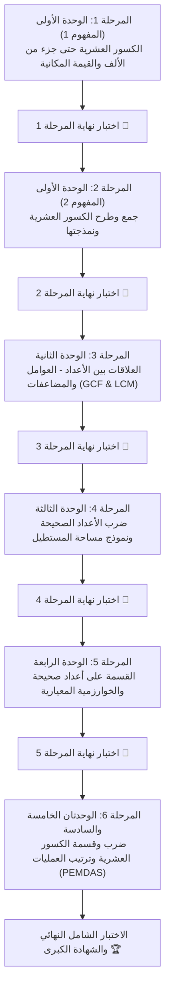

# خطة تطوير منصة الرياضيات التفاعلية - الصف الخامس الابتدائي (ترم أول 2027)
## مرجع المنهج المعتمد: كتاب "الأضواء في الرياضيات 5ب - الفصل الدراسي الأول"

---

## 1. وصف الهدف والمشروع (Goal Description)
بناء بيئة ويب تعليمية تفاعلية حديثة، شيقة ومتكاملة، موجهة لطلاب الصف الخامس الابتدائي لتدريس وحدات ومفاهيم الرياضيات للفصل الدراسي الأول وفقاً لكتاب **"الأضواء رياضيات 5ب ترم أول 2027"** الموجود داخل مجلد المشروع.

### القواعد الإلزامية للمشروع:
1. **تقسيم المنهج إلى مراحل تدريجية (Units & Stages)** مستمدة حرفياً من كتاب الأضواء، تنتهي كل مرحلة باختبار تقييمي فوري تفاعلي لقياس الاستيعاب ومنح شهادة وشارة إتقان.
2. **منظومة الوسائط التفاعلية متعددة الحواس (Multimodal Learning)**:
   - **سرد وشرح صوتي باللغة العربية (Arabic Voice Narration)**: مدعوم بمحرك صوتي ونطق عربي فصيح وواضح للأطفال، مع تحكم كامل بالصوت والسرعة (`0.8x`, `1.0x`, `1.2x`) وتظليل تفاعلي للنص المشروح في الوقت الفعلي.
   - **معامل تفاعلية بصرية (Interactive Visual Manipulatives)**: أدوات رقمية عملية تتيح للطالب التفاعل اللمسي والبصري (جدول القيمة المكانية العشري، شبكة الأجزاء من مائة للتلوين والجمع والطرح، معمل مساحة المستطيل للضرب، شجرة العوامل الأولية ومخطط فن، ومحلل ترتيب العمليات خطوة بخطوة).
   - **شروحات فيديو تفاعلية (Interactive Video Player)**: مشغل فيديو تعليمي مدمج يحتوي على محطات توقف تفاعلية ذكية (`Checkpoints`) تطرح أسئلة سريعة لاختبار تركيز الطالب أثناء المشاهدة قبل المتابعة.
3. **قاعدة كتابة الأرقام والمعادلات (English Math Rule)**:
   - لغة التوجيه والشرح وسرد المفاهيم باللغة العربية الفصحى السلسة والمحفزة.
   - **كافة الأرقام والمعادلات الرياضية تظهر حصراً ودائماً بالأرقام الإنجليزية القياسية** (`0, 1, 2, 3... 9`) وصيغ المعادلات الإنجليزية القياسية (مثل `3.45 + 1.2 = 4.65`, `24 \times 15`, `\text{GCF}(12, 18) = 6`).
4. **التطبيق الصارم للهوية الموحدة الرسمية لوكالة eDesign (eDesign Agency Web UI & Branding Rules)**:
   - تضمين الشعار الأبيض الرسمي المعتمد عالي الدقة (Data URI) في الشريط العلوي والتذييل.
   - تضمين أيقونة المفضلة (Favicon Data URI) في الـ Head.
   - تذييل الصفحة المعتمد ذو الخلفية الزجاجية والاتجاه `direction: ltr;` مع حقوق الملكية وشارة `v4.0.0 Enterprise`.

---

## 2. مواءمة المنهج والمراحل وفقاً لكتاب "الأضواء رياضيات 5ب 2027"

تم فحص فهرس ومحتوى كتاب الأضواء بدقة، وتوزيع المنهج على **6 مراحل رئيسية متكاملة**:



### تفاصيل محتوى المراحل التعليمية من واقع كتاب الأضواء:

| المرحلة | الوحدة والمفهوم (كتاب الأضواء) | الدروس الرئيسية المستهدفة | الأداة والمعمل التفاعلي المصاحب |
| :--- | :--- | :--- | :--- |
| **المرحلة 1** | **الوحدة 1 / المفهوم 1**: الكسور العشرية حتى جزء من الألف | • الكسور العشرية حتى جزء من الألف (`Tenths, Hundredths, Thousandths`)<br/>• تغيير القيم المكانية بالضرب والقسمة على `10`<br/>• تكوين الكسور العشرية وتحليلها (الصيغة القياسية والممتدة)<br/>• مقارنة الكسور العشرية وترتيبها<br/>• تقريب الكسور العشرية لأقرب وحدة وجزء من عشرة ومائة | **معمل لوحة القيمة المكانية العشري (Place Value Lab)**:<br/>تحريك العدادات وتوليد الصيغة الممتدة والمعيارية ومقارنة عددين عشريين بيانياً. |
| **المرحلة 2** | **الوحدة 1 / المفهوم 2**: جمع وطرح الكسور العشرية | • تقدير مجموع الأعداد العشرية واستراتيجيات التقدير<br/>• نمذجة جمع وطرح الكسور العشرية بشبكات المائة<br/>• خوارزمية الجمع والطرح المعيارية مع محاذاة الفاصلة العشرية (`.` Decimal Point)<br/>• حل المسائل الكلامية الحياتية المتنوعة | **معمل شبكة المائة العشرية (Decimal 100-Grid Lab)**:<br/>شبكة ملونة تفاعلية يُظلل فيها الطالب بالضغط بالألوان لتمثيل ناتج الجمع والطرح بيانياً. |
| **المرحلة 3** | **الوحدة 2**: العلاقات بين الأعداد | • التعبيرات الرياضية والمعادلات والمتغيرات (`x, y, a`)<br/>• تحليل الأعداد إلى عواملها الأولية (`Prime Factors`) باستخدام شجرة العوامل<br/>• العامل المشترك الأكبر (`GCF` / ع.م.أ)<br/>• المضاعف المشترك الأصغر (`LCM` / م.م.أ) وعلاقة الأعداد ببعضها | **معمل شجرة العوامل ومخطط فن (Factor Tree & Venn Lab)**:<br/>تفكيك شجرة العوامل التفاعلية وتوزيع العوامل المشتركة في مخطط فن لحساب `GCF` و `LCM` بضغطة زر. |
| **المرحلة 4** | **الوحدة 3**: ضرب الأعداد الصحيحة | • استخدام نموذج مساحة المستطيل (`Area Model`) في الضرب<br/>• خاصية التوزيع في عملية الضرب (`Distributive Property`)<br/>• الضرب في عدد مكون من رقمين بالخوارزمية المعيارية<br/>• ضرب الأعداد متعددة الأرقام والمسائل الكلامية | **معمل نموذج مساحة المستطيل للضرب (Area Model Multiplier)**:<br/>إدخال أي عددين (مثل $34 \times 18$) لتقسيم المستطيل تلقائياً لحساب النواتج الجزئية وجمعها. |
| **المرحلة 5** | **الوحدة 4**: القسمة على أعداد صحيحة | • استخدام النماذج في القسمة ومساحة المستطيل<br/>• تقدير خارج القسمة (`Quotient Estimation`)<br/>• خوارزمية القسمة المعيارية (القسمة المطولة خطوة بخطوة: اقسم، اضرب، اطرح، أنزل الرقم)<br/>• إيجاد الباقي (`Remainder`) والتحقق من صحة الحل | **مساعد القسمة المطولة التفاعلي (Long Division Visualizer)**:<br/>حل خطوات القسمة خطوة بخطوة مع توضيح نواتج الطرح وتنزيل المنازل بصرياً. |
| **المرحلة 6** | **الوحدتان 5 و 6**: الكسور العشرية وترتيب العمليات | • الضرب والقسمة في قوى العدد `10` وملاحظة حركة العلامة العشرية<br/>• ضرب وقسمة الكسور العشرية<br/>• ترتيب إجراء العمليات الحسابية (الأقواس ثم الضرب/القسمة ثم الجمع/الطرح `PEMDAS`)<br/>• كتابة التعبيرات العددية واكتشاف الأنماط | **معمل مصفوفة العمليات وترتيبها (PEMDAS Engine)**:<br/>تحليل التعبير الرياضي واقتناص العملية ذات الأولوية وتوهجها وتفكيكها مرحلة تلو الأخرى. |

---

## 3. المعمارية التقنية للمنصة (Technical Architecture)

سيتم إنشاء وتطوير المنصة بتطبيق ويب أحادي الصفحة (SPA) فائق السرعة والأناقة مبني على:
- **Vite + React 18**: لتفاعل سلس واستجابة فورية خالية من أي بطء.
- **Tailwind CSS**: تصميم عصري داكن أنيق (Dark Glassmorphism) يتماشى مع هوية eDesign Agency.
- **Lucide Icons**: أيقونات تعليمية متناسقة وجذابة.
- **Canvas Confetti**: احتفالات بصرية ومحفزة للطفل عند اجتياز الاختبارات وحصد النقاط.
- **Web Speech API**: توليد الصوت الطبيعي والنطق العربي الفصيح للشروحات مع تظليل النص.
- **HTML5 Canvas / SVG**: لتجسيد المعامل الرقمية والشبكات التفاعلية والرسوم البيانية بدقة وتفاعلية كاملة.
- **Local Storage**: حفظ تقدم الطالب تلقائياً، الشارات المحرزة، ونتائج الاختبارات والشهادات.

### خريطة ملفات المشروع المقترحة:
```
c:\Users\Ezz\MyFile\projects\Mody\Math/
├── index.html                           # صفحة البداية مع شعار eDesign وهوية الوكالة والـ Favicon
├── package.json                         # إعدادات الحزم (React, Lucide, Canvas-confetti, Tailwind)
├── vite.config.js                       # إعدادات Vite
├── tailwind.config.js                   # إعدادات سمة الألوان والخطوط والأرقام
├── src/
│   ├── main.jsx                         # نقطة الانطلاق
│   ├── App.jsx                          # إدارة مسار التعلم والمراحل النشطة
│   ├── index.css                        # التنسيقات العامة والخطوط وأرقام Tabular LTR
│   ├── data/
│   │   ├── curriculumData.js            # كامل شروحات المنهج ومفاهيم كتاب الأضواء ومحتوى الفيديو والصوت
│   │   └── quizzesData.js               # بنوك الأسئلة المتدرجة لاختبارات نهاية كل مرحلة مع التغذية الراجعة
│   ├── components/
│   │   ├── layout/
│   │   │   ├── Header.jsx               # الشريط العلوي مع شعار eDesign، مسار التقدم، والنجوم المكتسبة
│   │   │   └── Footer.jsx               # تذييل eDesign الرسمي الموحد بالمعايير المطلوبة
│   │   ├── navigation/
│   │   │   ├── StageRoadmap.jsx         # خريطة مراحل المنهج التفاعلية مع شارات القفل والإنجاز
│   │   │   └── StageProgress.jsx        # بطاقة إحصاءات الطالب ومستوى إتقانه
│   │   ├── stage/
│   │   │   ├── StageViewer.jsx          # الشاشة الرئيسية لعرض المرحلة والتبديل بين الشرح والمعمل والاختبار
│   │   │   ├── AudioNarrator.jsx        # مشغل الصوت التفاعلي مع التحكم بالسرعة وتظليل القراءة
│   │   │   ├── VideoPlayer.jsx          # مشغل الفيديو التعليمي مع محطات الأسئلة التفاعلية (Checkpoints)
│   │   │   └── ConceptLesson.jsx        # عرض شرح الدروس والرسوم التوضيحية مع تطبيق الأرقام الإنجليزية
│   │   ├── labs/                        # المعامل الرقمية التفاعلية:
│   │   │   ├── PlaceValueLab.jsx        # معمل القيمة المكانية العشري ومقارنة الأعداد
│   │   │   ├── DecimalGridLab.jsx       # معمل شبكة الـ 100 لجمع وطرح الكسور
│   │   │   ├── AreaModelLab.jsx         # معمل مساحة المستطيل لعمليات الضرب
│   │   │   ├── FactorTreeLab.jsx        # معمل شجرة العوامل ومخطط فن لـ GCF و LCM
│   │   │   ├── LongDivisionLab.jsx      # مساعد القسمة المطولة خطوة بخطوة
│   │   │   └── PemdasLab.jsx            # معمل ترتيب العمليات الحسابية
│   │   ├── assessment/
│   │   │   ├── QuizEngine.jsx           # محرك الاختبارات والتصحيح الفوري والشرح النموذجي
│   │   │   └── CertificateModal.jsx     # شهادة إتقان قابلة للطباعة والتحميل باسم الطالب
│   │   └── common/
│   │       ├── MathBadge.jsx            # شارات الإنجاز والدرجات
│   │       └── SoundEffects.js          # مؤثرات صوتية تشجيعية (Web Audio API)
│   └── utils/
│       ├── speechService.js             # محرك النطق العربي الفصيح وإدارة القراءة
│       └── progressStorage.js           # إدارة وحفظ بيانات ودرجات الطالب
```

---

## 4. خطة التحقق والاختبار (Verification Plan)

### التحقق التقني والآلي:
1. تثبيت الحزم المطلوبة بنجاح والتحقق من عدم وجود أي تعارض في التبعيات.
2. تشغيل أمر `npm run build` للتأكد من نجاح التحزيم (Vite Bundle) وخلو الكود من أي خطأ نحوي أو استيراد مفقود.
3. تشغيل خادم التطوير محلياً واختبار واجهة المستخدم.

### التحقق البصري والوظيفي:
1. **التحقق التام من كتابة الأرقام والمعادلات**:
   - التأكد أن جميع الأرقام تظهر بالأرقام الإنجليزية القياسية `0, 1, 2, ... 9` دون أي ظهور للأرقام الهندية أو الشرقية.
   - التأكد من ضبط اتجاه كتابة المعادلات الرياضية من اليسار إلى اليمين (LTR).
2. **التحقق من هوية eDesign الموحدة**:
   - تطابق الشعار الأبيض في الهيدر والفوتر والـ Favicon في رأس الصفحة مع مواصفات الـ Data URI الرسمية.
   - التحقق من شريط التذييل الموحد باتجاه `direction: ltr;` وشارات `v4.0.0 Enterprise`.
3. **التحقق من المعامل والأدوات التفاعلية الستة**:
   - اختبار معمل القيمة المكانية (إدخال الأعداد وقراءة الصيغ).
   - اختبار معمل شبكة الـ 100 (تلوين الأجزاء وملاحظة ناتج الجمع والطرح).
   - اختبار معمل مساحة المستطيل (تغيير أبعاد الضرب وحساب المساحات الجزئية).
   - اختبار شجرة العوامل واستخراج `GCF` و `LCM`.
   - اختبار مساعد القسمة المطولة ومعمل ترتيب العمليات.
4. **التحقق من الشرح الصوتي والفيديو والاختبارات**:
   - تشغيل السرد الصوتي والتأكد من وضوح النطق والتحكم في السرعات.
   - تجربة اختبار نهاية مرحلة معينة وحل الأسئلة ورؤية التغذية الراجعة والاحتفال وإصدار شهادة الإنجاز.
